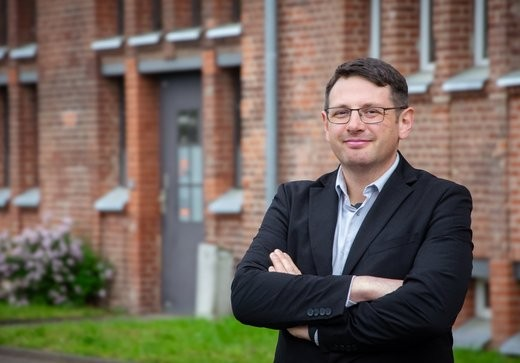

Zum 1. Oktober 2026 hat PD Dr. Alexander E. Sollee die Nachfolge von Prof. Dr. Philipp von Rummel als Generalsekretär des Deutschen Archäologischen Instituts angetreten. Er übernimmt damit zugleich die Rolle des Sprechers des Konsortium NFDI4Objects (nach BLV). 

Alexander Sollee ist Vorderasiatischer Archäologe und seit 2023 an der Martin-Luther-Universität Halle-Wittenberg für das Fach Orientalische Archäologie und Kunstgeschichte verantwortlich. 2016 promovierte er an der Universität Bern zu neuassyrischen Befestigungsanlagen, 2025 habilitierte er sich dort zur Entwicklung und Organisation von Unterstädten im späthethitischen Kulturraum.

Seine Forschungsschwerpunkte liegen in der eisenzeitlichen Archäologie Vorderasiens sowie im Einsatz digitaler Methoden und Geoinformationssysteme zur Dokumentation und Analyse archäologischer Befunde. Darüber hinaus engagiert er sich im Forschungsdatenmanagement und bringt Erfahrungen aus verschiedenen archäologischen Forschungs- und Grabungsprojekten ein.

Wir freuen uns darüber, Alexander Sollee an Bord zu haben und wünschen ihm viel Erfolg für seine zukünftigen Aufgaben! Zugleich bedanken wir uns bei seinem Vorgänger Philipp von Rummel für seine hervorragende Arbeit und sein überwältigendes Engagement.

 