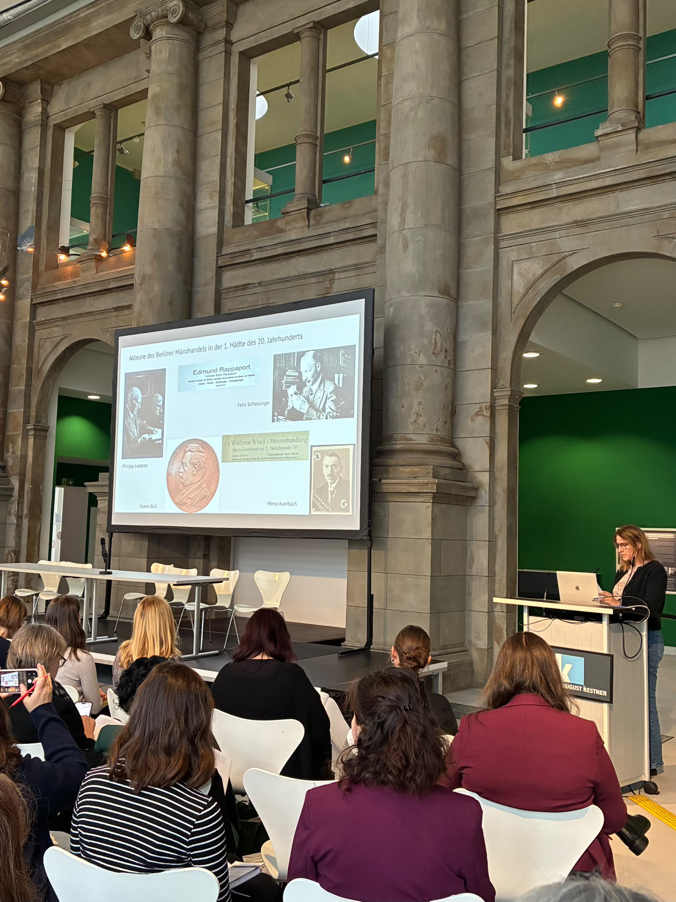

Letzte Woche war unsere Kollegin Angela Berthold in Hannover auf der Jahrestagung des Arbeitskreises Provenienzforschung!

Mit einem Vortrag zum Berliner Münzhandel in der Zeit von 1933-1945 hat Sie das Programm bereichert und einen interessanten Einblick in die Forschung zur digitalen Provenienzforschung geliefert. 

Grundlage waren digitalisierte Archivunterlagen des Berliner Münzkabinetts wie Korrespondenz, Erwerbungsregister und Besucherbücher. Sie machen den Münzhandel, die Verfolgung der Händler und die Monopolisierung des Marktes besser nachvollziehbar. Außerdem ging es darum, wie das Münzkabinett Provenienzforschung strategisch verankert: durch Digitalisierung, Weiterbildung und Citizen Science. 

 

Foto: D. Schön