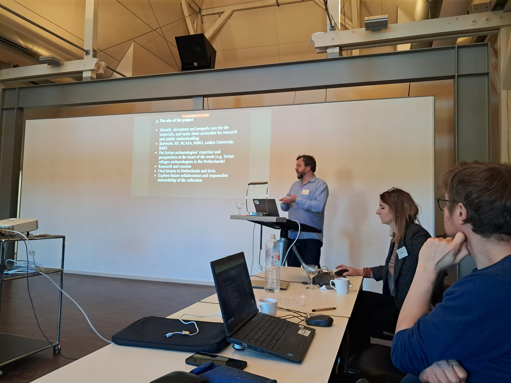
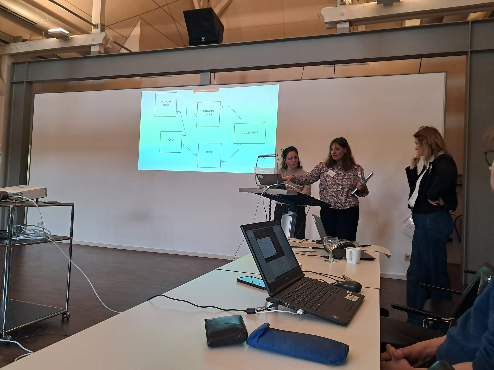

Der Workshop „Provenienzdaten archäologischer Objekte: Spezifika, Quellen, Methoden, Herausforderungen“,  fand vom 12. bis 13. November 2026 im Brugsch-Pascha-Saal des  Archäologischen Zentrums in Berlin-Mitte sowie hybrid im Kontext  der diesjährigen NFDI4Objects Workshopreihe statt. Er wurde  ausgerichtet von der TA2 Collecting im Rahmen der Arbeiten des Community  Cluster Digitale Provenienzforschung und des Trail [Digitale Provenienzforschung: Methoden, Konzepte und Normdaten zu Personennamen](https://www.nfdi4objects.net/trails/2.4_second_TRAILs/)

Der Workshop führte internationale Expertinnen und  Experten aus Museen, Universitäten, Archiven und Forschungseinrichtungen  zusammen. Im Fokus standen die spezifischen Herausforderungen von  Provenienzdaten im archäologischen Kontext – von  kolonialen Erwerbungskontexten und Raubgrabungen bis hin zu illegalem  Handel. Besonderes Augenmerk lag auf der digitalen Erfassung, der  Vernetzung heterogener Datenbestände und dem Umgang mit Fehlstellen.

  
 Im eröffnenden Panel I „Archäologische Provenienzdaten abbilden und  verknüpfen“ stellten Clara Bernard und Juliette Tanré-Szewczyk (Institut national d'histoire de l'art, Paris) das Répertoire des ventes d’antiques en France au XIXe siècle sowie das Projekt IMENTET zur Erforschung antiker Objektverkäufe vor. Anschließend  beleuchtete Pallabi Bagchi (Maharaja Sayajirao University of Baroda)  Strategien zum Umgang mit bekannten, erschlossenen und unsicheren, vagen  Daten bei Pāla-zeitlichen buddhistischen Objekten.

Wu-Wei Chen (Xi'an Jiaotong-Liverpool University)  diskutierte datenwissenschaftliche Ansätze und die Rolle strategischer  bildlicher Erfassung als Antrieb für die Provenienzforschung.

Im zweiten Panel „Archäologische  Provenienzforschung in Sammlungen“ berichteten  Sammlungsmitarbeiter\*innen aus der Praxis. Für die universitären  Lehrsammlungen zeigten Agnes Henning und Hannah Kempin  (Winckelmann-Institut der HU Berlin)  sowie Polly Lohmann (Universität Heidelberg) auf, wie auch mit geringen  Ressourcen Archivbestände erschlossen und digital sichtbar gemacht  werden können. Rogier Kalkers (Allard Pierson Museum Amsterdam)  plädierte für einen proaktiven und gemeinschaftlichen  Ansatz in der Sammlungsforschung und stellte seine Arbeit an einem  Beispiel vor. Erik Beck (Kreismuseum Wewelsburg) analysierte die  methodischen Hürden und fragmentarischen Überlieferungen bei der  Untersuchung der ehemaligen archäologischen SS-Sammlung in  Wewelsburg.

In Panel III widmeten sich vier Beiträge den  rechtlichen, ethischen und praktischen Aspekten archäologischer  Provenienzdaten. Zu Beginn berichtete Stijn van Rossem (Universität  Amsterdam) von Paradigmenwechsel von reinem Eigentum hin zu  ethischer Verantwortung und geteilter Betreuung (Shared Stewardship), der sich momentan in seiner Einrichtung vollzieht. Kyra Maren Gospodar (Polizei Berlin / FU Berlin) beleuchtete an Hand von „Circulating Coins“ die Rekonstruktion von Objektprovenienzen im  Schnittfeld von Strafverfolgung und Kulturwissenschaft. Holger Neumer  (MLU Halle) analysierte die argumentative Aushandlung von  Rückgabeforderungen (am Beispiel Nofretete, Pergamonaltar  und Ischtar-Tor) im 20. und 21. Jahrhundert. Will Korner (CHARD  Foundation) schloss die Fachvorträge mit der Frage ab, wie  Due-Diligence-Praktiken und Provenienzrecherchen angesichts aktueller  Konfliktzonen angepasst werden müssen.

Die Abschlussdiskussion betonte die Wichtigkeit,  disziplinäre Grenzen zwischen Archäologie, Recht, Informatik und  Museologie weiter aufzubrechen. Insbesondere die standardisierte  Verknüpfung von Provenienzdaten im Sinne der FAIR-Prinzipien  und die Etablierung nachhaltiger digitaler Workflows innerhalb von  Infrastrukturen wie NFDI4Objects wurden als zentrale Aufgaben für  künftige Forschungsprojekte identifiziert.

 

 