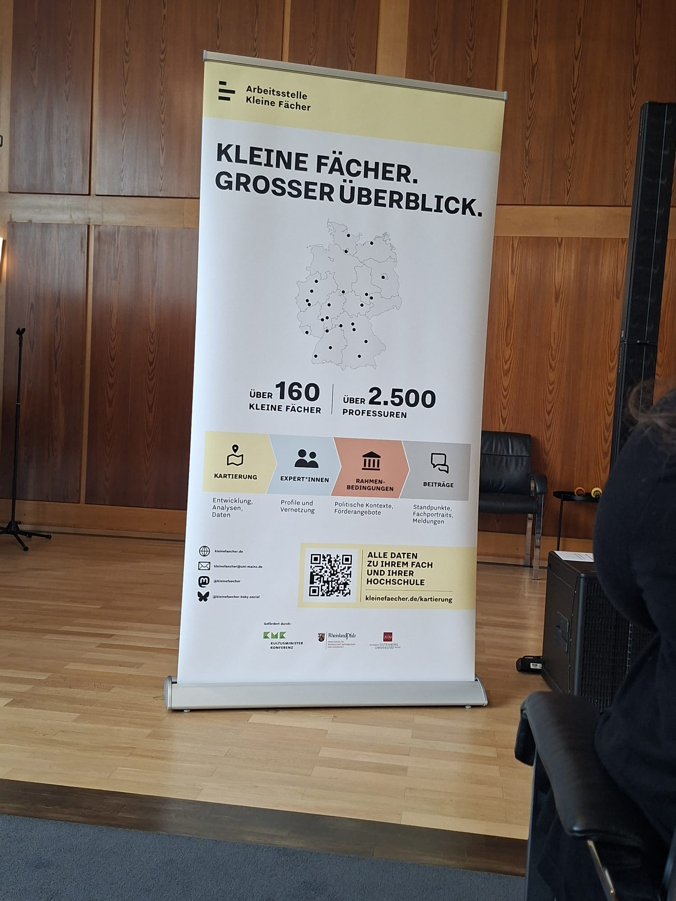
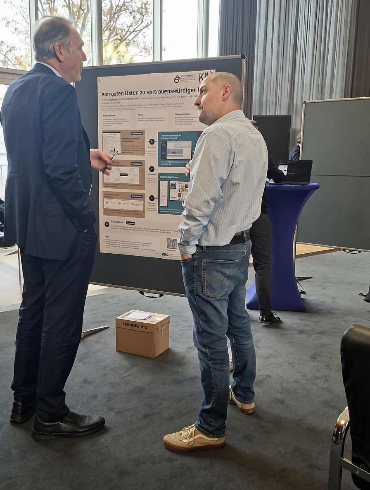
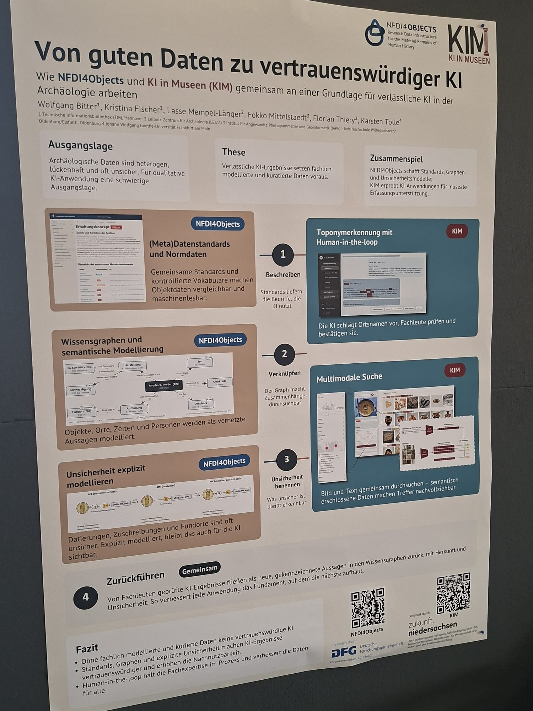

Bei der Tagung „Künstliche Intelligenz und die Zukunft kleiner Fächer“, veranstaltet von der Akademie der Wissenschaften und der Literatur Mainz, präsentierten Wolfgang Bitter, Kristina Fischer, Lasse Mempel-Länger, Fokko Mittelstaedt, Florian Thiery und Karsten Tolle ihr Poster „Von guten Daten zu vertrauenswürdiger KI – Wie NFDI4Objects und KI in Museen (KIM) gemeinsam an einer Grundlage für verlässliche KI in der Archäologie arbeiten“.

Die Tagung zeigte, wie dynamisch sich das Feld rund um KI und ihren Einsatz in kleinen Fächern wie der Archäologie entwickelt. Wir freuen uns auf die weiteren Entwicklungen und den fortgesetzten Austausch.

Vielen Dank an Angela Berthold für die Bilder!

  <figure>
    
    <figcaption>Bild: Angela Berthold</figcaption>
  </figure>
  <figure>
    
    <figcaption>Bild: Angela Berthold</figcaption>
  </figure>
  <figure>
    
    <figcaption>Bild: Angela Berthold</figcaption>
  </figure>

