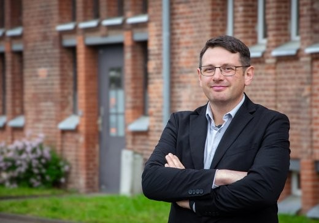

On 1 October 2026, PD Dr Alexander E. Sollee succeeded Prof. Dr Philipp von Rummel as Secretary-General of the German Archaeological Institute. He has also taken on the role of spokesperson for the NFDI4Objects consortium (under the BLV).

On 1 October 2026, PD Dr Alexander E. Sollee succeeded Prof. Dr Philipp von Rummel as Secretary-General of the German Archaeological Institute. He has also taken on the role of spokesperson for the NFDI4Objects consortium (under the Federal-State Agreement).

Alexander Sollee is an archaeologist specialising in the Ancient Near East and has been head of the Department of Oriental Archaeology and Art History at Martin Luther University Halle-Wittenberg since 2023. In 2016, he obtained his PhD from the University of Bern on Neo-Assyrian fortifications; in 2025, he completed his habilitation there on the development and organisation of lower towns in the Late Hittite cultural sphere.

His research focuses on Iron Age archaeology in the Ancient Near East, as well as on the use of digital methods and geoinformation systems for the documentation and analysis of archaeological finds. In addition, he is actively involved in research data management and brings experience from various archaeological research and excavation projects.

We are delighted to have Alexander Sollee on board and wish him every success in his future endeavours! At the same time, we would like to thank his predecessor, Philipp von Rummel, for his outstanding work and his tremendous dedication.

 