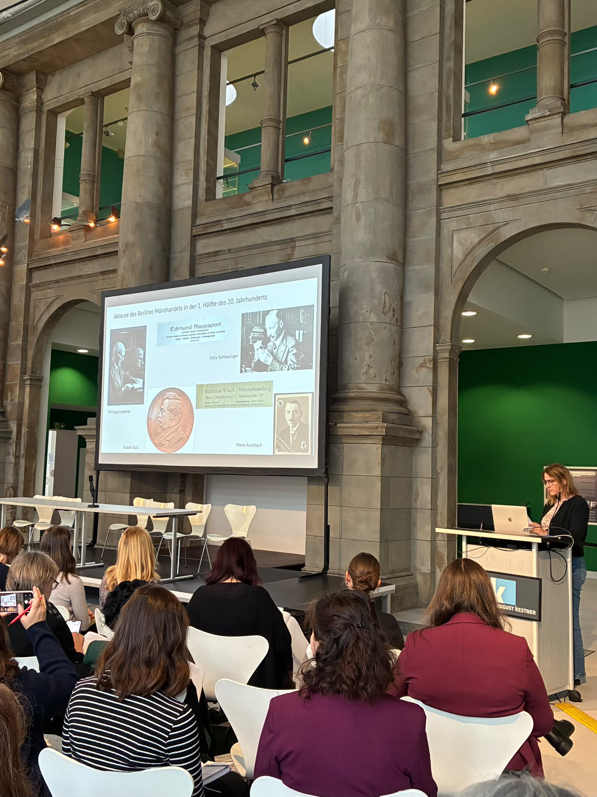

Last week, our colleague Angela Berthold attended the annual conference of the Working Group for Provenance Research (Arbeitskreis Provenienzforschung) in Hanover!

She enriched the program with a presentation on the coin trade in Berlin between 1933 and 1945, offering an intriguing look into research in the field of digital provenance.

Her work was based on digitized archival records from the Berlin Coin Cabinet (Münzkabinett), including correspondence, acquisition registers, and visitor logs. These documents provide a clearer understanding of the coin trade, the persecution of dealers, and the monopolization of the market. Furthermore, the presentation addressed how the Coin Cabinet is strategically embedding provenance research into its operations—through digitization, professional development, and citizen science.  
  

 