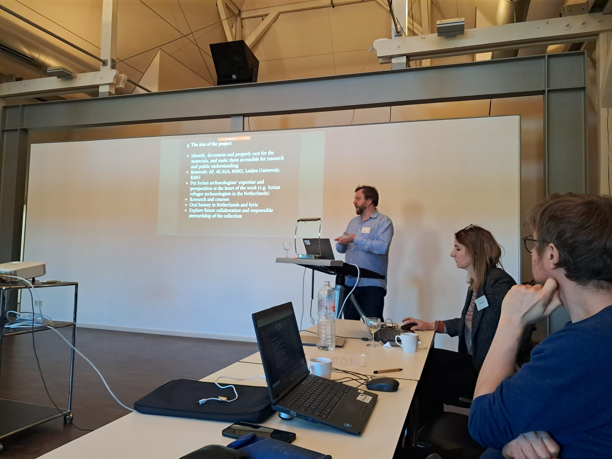
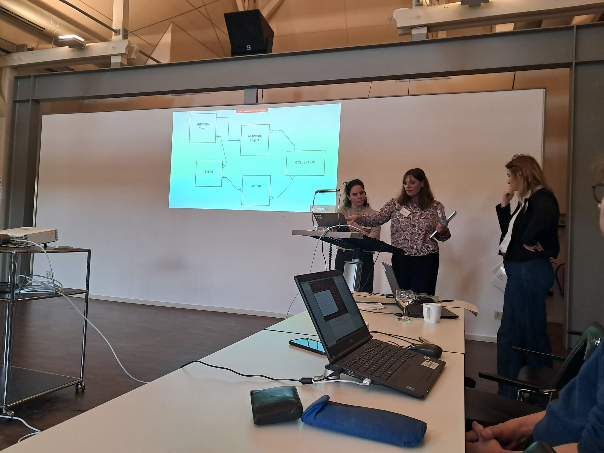

The workshop ‘Provenance Data for Archaeological Objects: Specifics, Sources, Methods, Challenges’ took place from 12 to 13 November 2026 in the Brugsch-Pascha Hall at the Archaeological Centre in Berlin-Mitte, as well as in a hybrid format as part of this year’s NFDI4Objects workshop series. It was organised by TA2 Collecting as part of the work of the Community Cluster on Digital Provenance Research and the Trail [Digital Provenance Research: Methods, Concepts and Standardised Data on Personal Names](https://www.nfdi4objects.net/trails/2.4_second_TRAILs/)

The workshop brought together international experts from museums, universities, archives and research institutions. The focus was on the specific challenges posed by provenance data in an archaeological context – ranging from colonial acquisition contexts and looting to illicit trade. Particular attention was paid to digital recording, the linking of heterogeneous datasets and the handling of missing data.

In the opening Panel I, ‘Mapping and linking archaeological provenance data’, Clara Bernard and Juliette Tanré-Szewczyk (Institut national d’histoire de l’art, Paris) presented the *Répertoire des ventes d’antiques en France au XIXe siècle* and the IMENTET project, which investigates the sale of ancient artefacts. Pallabi Bagchi (Maharaja Sayajirao University of Baroda) then examined strategies for dealing with known, catalogued and uncertain, vague data relating to the Pāla period.

Wu-Wei Chen (Xi’an Jiaotong-Liverpool University) discussed data science approaches and the role of strategic visual documentation as a driver for provenance research.

In the second panel, ‘Archaeological Provenance Research in Collections’, collection staff shared insights from their practical experience. With regard to university teaching collections, Agnes Henning and Hannah Kempin (Winckelmann Institute at HU Berlin) and Polly Lohmann (University of Heidelberg) demonstrated how archive holdings can be catalogued and made digitally accessible even with limited resources. Rogier Kalkers (Allard Pierson Museum, Amsterdam)  called for a proactive and collaborative  approach to collection research and presented his work using a  case study. Erik Beck (Wewelsburg District Museum) analysed the  methodological hurdles and fragmentary records encountered whilst  investigating the former SS archaeological collection in  Wewelsburg.

In Panel III, four presentations addressed the legal, ethical and practical aspects of archaeological provenance data. To begin with, Stijn van Rossem (University of Amsterdam) reported on the paradigm shift from pure ownership towards ethical responsibility and shared stewardship, which is currently taking place at his institution. Kyra Maren Gospodar (Berlin Police / Free University of Berlin) used the example of ‘circulating coins’ to examine the reconstruction of object provenance at the intersection of criminal justice and cultural studies. Holger Neumer (MLU Halle) analysed the argumentative negotiation of restitution claims (using the examples of Nefertiti, the Pergamon Altar and the Ishtar Gate) in the 20th and 21st centuries. Will Korner (CHARD Foundation) concluded the specialist presentations by asking how due diligence practices and provenance research need to be adapted in light of current conflict zones.

The concluding discussion emphasised the importance of further breaking down disciplinary boundaries between archaeology, law, computer science and museology. In particular, the standardised linking of provenance data in line with the FAIR principles and the establishment of sustainable digital workflows within infrastructures such as NFDI4Objects were identified as key tasks for future research projects.

 

 