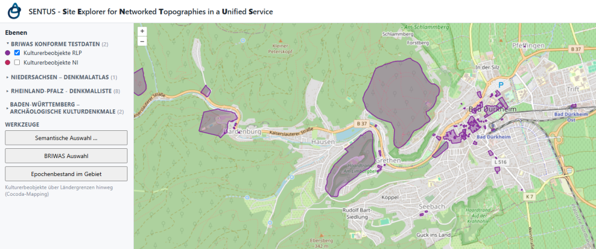

## Geodaten strukturiert und standardisiert

Räumliche, denkmalbezogene Daten, die unter anderem bei Landesdenkmalämtern und Universitäten entstehen, stellen eine der wichtigsten Quellen beim Verständnis vergangener Epochen dar. Um diese heterogenen Daten erschließen und auswerten zu können, müssen sie vielfach mühsam zusammengetragen und umgewandelt werden.

 

SENTUS (*proto-keltisch für „Pfad”*) beschreibt Geodatendienste für räumliche Metadaten zu Kulturerbeobjekten, Schutzflächen und Maßnahmen, die OGC- und BRIWĀS-konform angelegt sind, um die Erschließung dramatisch zu vereinfachen.

## Standardisierte Dienste

Metadaten, die den [BRIWĀS](https://www.nfdi4objects.net/services/briwas/) Community Standards entsprechen, können ohne großen Aufwand und kontinuierlich als Web-Feature-Services veröffentlicht werden.
Dank der Standardisierung können räumliche Daten aus unterschiedlichen Systemen gemeinsam verarbeitet werden. Unter Verwendung von Mappings auf die BRIWĀS Basisvokabulare werden die Daten darüber hinaus auch inhaltlich vergleichbar.

Das ermöglicht gemeinsame Abfragen zum Erschließen separater Datenquellen und erlaubt beispielsweise folgende Fragestellungen:
- "Zeige mir deutschlandweit alle römischen Befestigungsanlagen."
- "Zeige mir alle Hügelgräber nördlich der Rhein aus allen Epochen."
- "Zeige mir alle eisenzeitlichen Höhensiedlungen, bei denen bereits eine Ausgrabung stattgefunden hat."

## Site Explorer WebGIS

 

Zusätzlich soll eine plattformunabhängige WebGIS-Anwendung entstehen, die verfügbar gemachte SENTUS Geodatendienste in einer einfachen Benutzeroberfläche erkundbar macht.
Dadurch werden Metadaten zu Kulturerbeobjekten, Schutzflächen und Maßnahmen ohne lokale Installation an einer Stelle einsehbar. Such- und Filterfunktionen werden es darüber hinaus erlauben deutschlandweit genau die Daten zu finden, die man für die eigene Forschungsfrage benötigt.
Dieses niedrigschwellige Angebot wird den reichen Datenschatz der teilnehmenden Landesdenkmalämter für ein breites Publikum öffnen.

## Aktueller Stand
Die Generaldirektion Kulturelles Erbe Rheinland-Pfalz betreibt zu Testzwecken einen SENTUS Geodatendienst, der zukünftig über das Geoportal RLP veröffentlicht werden wird. Weitere Denkmalbehörden haben ebenfalls zugesagt, entsprechende Tests zu unternehmen.
Ein QGIS-Plugins, das Daten in unterschiedlichen BRIWĀS-konformen Geodatendiensten nach gemappten Begriffen filtern wird, befindet sich in einer Prototyp-Version. Bisher erlaubt es bereits das Filtern nach Datierungsbegriffen.
Zukünftig werden Dokumentationen und Hilfestellungen dabei unterstützen, SENTUS Geodatendienste für die eigenen Daten zu erstellen.
