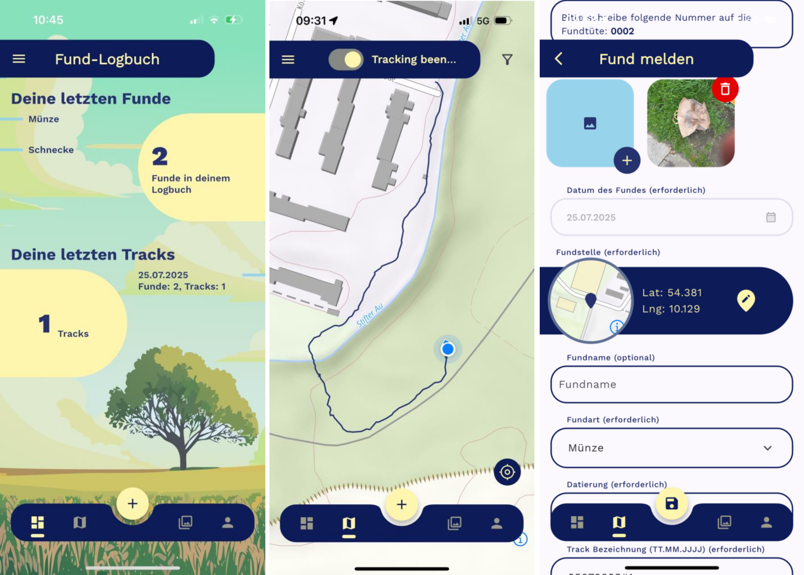

## Citizen Science

Viele archäologische Kleinfunde werden von Sondengänger:innen, Zufallsfinder:innen und Ehrenamtlichen gemeldet. Für die Bodendenkmalpflege sind diese Meldungen wichtig, und für die Forschung sind sie eine bedeutende Quelle, die oft zu wenig beachtet wird. Analoge Meldewege sind jedoch zeitintensiv und fehleranfällig. Auswertung und konservatorische Maßnahmen verzögern sich, und viele Daten erreichen die Forschung spät oder gar nicht. Das Fund-Logbuch verarbeitet Fundmeldungen von der Erfassung bis in die Fachsysteme der Denkmalbehörden durchgehend digital. So fließen neue Funde schneller in Denkmalschutz und Forschung ein, und die Zusammenarbeit zwischen Behörden und Ehrenamtlichen wird gestärkt.

## Das Fund-Logbuch

Das Fund-Logbuch ist eine neue Prozesskette, die Daten von Anfang an basierend auf gemeinsamen Standards strukturiert und lückenlos digital verarbeitet. Bisher bestehende Fehlerquellen werden durch Automatisierungen in der Erfassung und das fehlen von Medienbrüchen konsequent vermieden.

 

### App

Funde, Fundstellen und Fundumstände lassen sich direkt vor Ort mit dem Smartphone erfassen und hochladen. Eingabehilfen und die Standortbestimmung des Smartphones erleichtern die Dokumentation.

### Webportal

Finder:innen sehen ihre eigenen Meldungen in einer zentralen Datenbank ein und können sie prüfen.

### Verteilmechanismus

Die zuständigen Fachbehörden übernehmen die Meldungen über genormte Schnittstellen direkt in ihre Fachsysteme. Von dort werden sie weiterverarbeitet und der Forschung bereitgestellt.

## Ein gemeinsamer Standard

Eine Grundlage für das Fund-Logbuch ist die Entwicklung des [BRIWĀS](/services/briwas/) Community-Standard für Citizen-Science-Daten im NFDI4Objects Community Cluster [„Protected Heritage Sites“](https://community.nfdi4objects.net/de/assemblies/HeritageSites). Durch diesen werden die entstehenden Daten interoperabel und nachhaltig nutzbar.

## Entwicklung und Einsatz

Erstmals eingesetzt und erprobt wurde die App in Sachsen-Anhalt. Weiterentwickelt wird das Fund-Logbuch im NFDI4Objects Community Cluster [„Public Archaeology“](https://www.nfdi4objects.net/ccs/cc_citizen_science_and_community_hubs/). Die hier entstehende Infrastruktur soll künftig allen interessierten Fachbehörden offenstehen.
