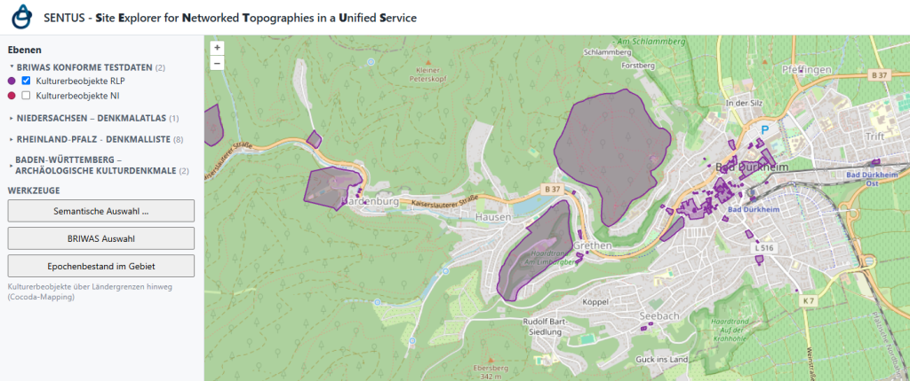

## Structured and Standardized Geospatial Data

Spatial heritage data, produced by state heritage authorities and universities among others, is one of the most important sources for understanding past periods. To integrate and interpret these heterogeneous datasets, researchers often have to laboriously compile and transform them.

 

SENTUS (*Proto-Celtic for “path”*) refers to OGC- and BRIWĀS-compliant spatial data services that provide metadata on cultural heritage items, protected sites and measures. These services are designed to greatly simplify data integration.

## Standardized Services

Metadata that complies with the [BRIWĀS](https://www.nfdi4objects.net/en/services/briwas/) metadata standards can be published continuously and with little effort as OGC Web Feature Services (WFS).

Thanks to standardization, spatial data from different systems can be processed in unison. Additionally, mappings to the BRIWĀS core vocabularies make the data semantically comparable.

This enables joint queries across separate data sources, making it possible to address questions such as:
- “Show me all Roman fortifications across Germany.”
- “Show me all burial mounds north of the Rhine from all periods.”
- “Show me all Iron Age hilltop settlements where excavations took place.”

## Site Explorer WebGIS

 

In addition, a platform-independent web GIS application is planned that will allow users to explore published SENTUS spatial data services through a simple user interface.
This will make metadata on cultural heritage items, protected sites and measures viewable in one place, without any local installation. Search and filter functions will also help users find exactly the data they need for their research questions, across all of Germany.
This easily accessible service will open up the wealth of data held by participating state heritage authorities to a broad audience.

## Current Status

The General Directorate of Cultural Heritage Rhineland-Palatinate (GDKE) is currently testing a SENTUS spatial data service, which will be published via the Rhineland-Palatinate geoportal (GeoPortal.rlp) in the future. Other state heritage authorities have also committed to carrying out corresponding tests.
A QGIS plugin that will filter data across different BRIWĀS-compliant spatial data services by mapped vocabulary terms is currently at the prototype stage. It already supports filtering by period terms.
In the future, documentation and guidance will help users deploy SENTUS spatial data services for their own data.
