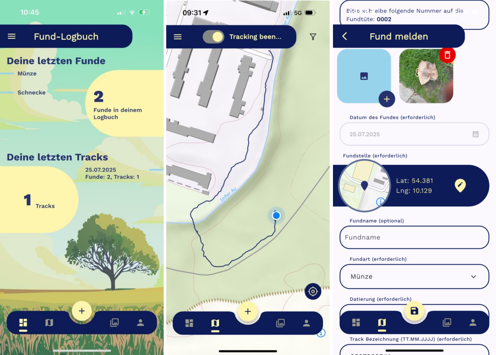

## Citizen Science

Many archaeological small finds are reported by metal detectorists, chance finders, and volunteers. These reports are important for the preservation of archaeological sites, and they serve as a significant source of information for research that is often overlooked. However, traditional reporting methods are time-consuming and prone to errors. Analysis and conservation efforts are delayed, and much of the data reaches researchers late, or not at all. The Fund-Logbuch processes reports of archaeological finds entirely digitally, from initial recording to integration into the specialized systems of the historic preservation authorities. This allows a quicker access of new finds for protective efforts and research, and strengthens collaboration between government agencies and volunteers.

## The Fund-Logbuch

The Fund-Logbuch is a new process chain that structures data based on common standards from the outset and processes it digitally without any gaps. Sources of error that existed previously are mitigated through automation in data capture and the elimination of media breaks.

 

### App

Finds, locations, and circumstances of discovery can be recorded and uploaded directly on site using a smartphone. Input assistance features and the smartphone's location tracking make documentation easy.

### Web Portal

Finders can review their own reports in a central database.

### Distribution Mechanism

The responsible agencies import the data directly into their own systems via standardized interfaces. From there, they can be processed further and made available to researchers.

## A Common Standard

Foundational for the Fund-Logbuch is the development of the \[BRIWĀS\](/services/briwas/) Community Standard for Citizen Science within the NFDI4Objects community cluster \[“Protected Heritage Sites”\](https://community.nfdi4objects.net/en/assemblies/HeritageSites). This standard ensures that the resulting data is interoperable and can be reused.

## Development and Deployment

The app was first deployed and tested in Saxony-Anhalt. Further development of the Fund-Logbuch is taking place in the NFDI4Objects Community Cluster \[“Public Archaeology”\](https://www.nfdi4objects.net/ccs/cc_citizen_science_and_community_hubs/). The infrastructure being developed here is intended to be open to all interested government agencies in the future.
